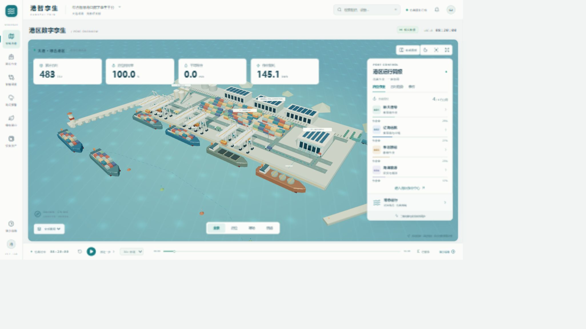

# 港智孪生 · GANGZHI TWIN

**面向大连综合港场景的三维运行与调度实验平台。**

把船舶、泊位、岸桥、运输车辆、冷链、能源和港区告警放在同一套业务状态中：在三维港区查看作业，注入海雾、大风、道路阻断或设备故障，再用相同输入比较基础策略与优化策略的仿真结果。

这是大学生竞赛原型。港区采用面向大连业务环境的示意布局，实体、任务、海况与运行指标均为明确标注的模拟数据；当前没有接入真实港口生产系统、实时 AIS 或实测气象数据，也不是大连港地理位置和设备的等比例复刻。

## 本地启动

Windows 推荐 Node.js 24、Python 3.12。首次启动需联网下载依赖。

双击根目录 **`启动港智孪生.bat`**，或在项目根目录运行：

```powershell
powershell -NoProfile -ExecutionPolicy Bypass -File scripts/start.ps1
```

脚本在本项目创建 Python 虚拟环境，安装前后端依赖，并在后台启动服务：

| 服务 | 地址 |
| --- | --- |
| 港智孪生界面 | http://127.0.0.1:5180/ |
| FastAPI 接口文档 | http://127.0.0.1:8011/docs |
| 后端健康检查 | http://127.0.0.1:8011/api/health |

进程记录与日志保存在 `.runtime/`，仅监听本机地址。重复启动会检查本项目已有进程；遇到其他程序占用端口会停止并提示，不会结束其他程序。

```powershell
# 依赖已就绪时快速启动，不自动打开浏览器
powershell -NoProfile -ExecutionPolicy Bypass -File scripts/start.ps1 -SkipInstall -NoBrowser

# 结束本项目启动的服务，保留仿真数据与日志
powershell -NoProfile -ExecutionPolicy Bypass -File scripts/stop.ps1
```

网络或安装失败时查看终端提示；服务启动失败时查看 `.runtime/backend.err.log` 和 `.runtime/frontend.err.log`。不要同时运行多份安装脚本。

## V0.2 明亮港区视图

首页采用浅色海图、白色悬浮面板和海蓝配色。三维港区铺满主要工作区，顶部保留四项紧凑指标，右侧运行简报可以收起；泊位、吞吐趋势和事件使用页签切换。默认日景，支持夜景、全景复位、场景专注模式和 Esc 返回。窄屏默认收起运行简报。



这次借鉴了 Portwise 原版的浅色海图和悬浮信息布局，保留本项目的中文界面、三维实体 ID 与 FastAPI 业务关联。改版过程与实际点击核查见 [设计核查记录](docs/DESIGN_REVIEW.md)。

## 产品组成

六个中文工作区为：**全域态势、港区作业、智能调度、海况预警、绿色港口、设备资产**。船舶与设备支持筛选和详情，调度实验展示成对作业甘特时间线与每船运输路径证据，支持导出本次运行的输入、时间线和指标；当前浏览器会话保留最近一次实验结果。

| 模块 | 行为 |
| --- | --- |
| 三维综合港区 | 集装箱码头、堆场、仓库、散货与冷链、岸电能源区、船舶和车辆；支持镜头切换、图层与实体选择 |
| 作业状态 | 船舶、设备、任务、告警和运营指标由 FastAPI 返回；前端按实体 ID 关联详情 |
| 仿真控制 | 开始、暂停、倍速、步进与重置；后端保存状态，便于刷新后继续 |
| 扰动场景 | 正常、海雾、大风、道路阻断、岸桥故障，影响作业能力或路线 |
| 调度实验 | 相同随机种子、船舶数量和场景下比较基础与优化策略，报告实际计算的等待、完工、距离和能耗结果 |
| 告警管理 | 查看关联实体和原因，确认后保留记录 |

细节与接口以当前代码及 FastAPI `/docs` 为准。算法输出属于教学仿真结果，改善幅度随输入变化；不能将演示结果解释成真实港口已获得的收益。

综合港运行模型分别统计集装箱/冷藏箱的 **TEU**、散货的**吨**和液货的**吨**，不把不同货种相加为 TEU。调度对照实验聚焦集装箱与冷藏箱，在三个抽象箱运泊位上运行；它与综合港实时场景的四个专用泊位属于不同模型。部分场景的优化方案可能完工更晚，应保留结果并解释等待、路径与能耗之间的取舍。

## 手动开发

前端：

```powershell
cd web-portwise
npm ci
npm run dev -- --host 127.0.0.1 --port 5180 --strictPort
```

后端，在另一个终端：

```powershell
cd backend
py -3.12 -m venv .venv
.venv\Scripts\python.exe -m pip --isolated install --no-user -r requirements.txt
.venv\Scripts\python.exe -m uvicorn app.main:app --host 127.0.0.1 --port 8011
```

默认数据库是 `backend/data/gangzhi.sqlite3`。需要独立实例时，在启动后端前设置 `GANGZHI_DB_PATH` 为另外的数据库路径。数据库、依赖和运行日志不纳入 Git。

```powershell
# 生产前端构建
cd web-portwise
npm run build

# 后端验证（在 backend 目录）
.venv\Scripts\python.exe -m pip --isolated install --no-user -r requirements-dev.txt
.venv\Scripts\python.exe -m pytest -q
```

本地原型以前后端共同运行为交付方式。构建前端得到 `web-portwise/dist/`；对外部署还需要配置 API 转发、持久化和实际运行环境，不能只上传静态文件便获得完整后端功能。

## 分支与回滚

产品分支：`feature/gangzhi-dalian-platform`。原始 Portwise 提交保留在标签 `upstream/portwise-original`，上游地址保存在 `upstream` remote；当前代码没有向他人的 GitHub 仓库推送。

查看或运行原版时，先提交或暂存自己的修改，再创建独立分支：

```powershell
git status
git switch -c review/original-portwise upstream/portwise-original

# 返回产品开发分支
git switch feature/gangzhi-dalian-platform
```

也可以在旁边创建独立工作目录查看原版，保留当前开发目录：

```powershell
git worktree add ../portwise-original upstream/portwise-original
```

## 来源与原创部分

本仓库从 [Portwise](https://github.com/alexngdev99/rork-seaport-logistics-3d) 的 MIT 工程基础和 Git 历史开始开发，保留原始许可证、提交与 `upstream/portwise-original` 标签。产品分支已清理未使用的新加坡页面、组件、场景、资产和依赖；原始源码可从标签或历史完整取回。当前中文产品入口、综合港三维方案、FastAPI 业务状态、调度实验与启停流程为新实现。

[HarborVision Twin](https://github.com/HUSNAIN-MUNAWAR/harborvision-twin) 与 [Port Operations Lab](https://github.com/egeakici/port-operations-lab) 作为业务分层、事件仿真及公平对照设计的参考。未将它们整套后端或展示界面直接合并。没有使用未发现许可证的 `3D_rendering_of_Porto` 代码或模型。

完整版本记录和贡献矩阵见 [THIRD_PARTY_NOTICES.md](THIRD_PARTY_NOTICES.md)。架构、数据边界和比赛演示建议见 [docs/ARCHITECTURE.md](docs/ARCHITECTURE.md)。

本地启动与生命周期核查记录见 [docs/VERIFICATION.md](docs/VERIFICATION.md)。
