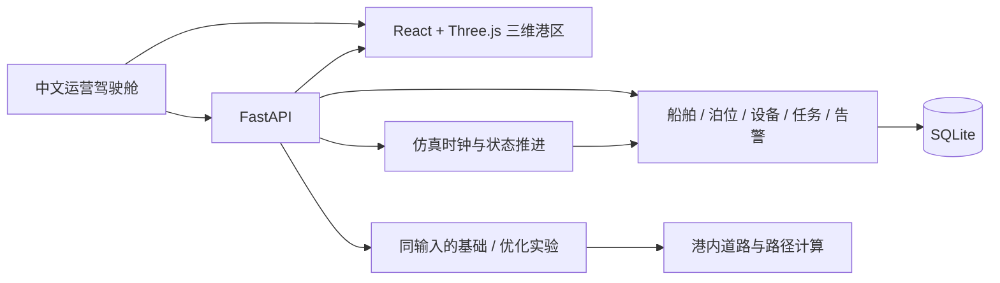

# 港智孪生的产品与技术边界

港智孪生的首个闭环是：查看港区 → 选择实体 → 注入扰动 → 比较调度策略 → 检查真实计算的仿真指标。界面应同时展示“模拟数据”状态，避免把运行中的三维动画理解成真实港口监控。



三维实体与业务记录使用同一 ID。渲染器负责几何、镜头、图层和运动展示，FastAPI 负责业务状态、操作校验、扰动和实验结果。前端页面刷新不应创建另一套独立业务时钟。

当前分支只保留产品需要的源码和依赖；原始新加坡港区页面、组件、场景与资产从产品目录清理，完整原版通过 `upstream/portwise-original` 标签和 Git 历史保留。

## 目录

```text
gangzhi-twin/
├── web-portwise/          React / TypeScript / Three.js 前端
│   └── src/gangzhi/       新产品界面与三维场景
├── backend/
│   ├── app/              FastAPI、仿真、实验与路径
│   ├── tests/            业务及 API 验证
│   └── data/             本地 SQLite（忽略提交）
├── scripts/              Windows 后台启停
├── docs/                 架构与演示说明
├── LICENSE               保留上游 MIT 许可证
└── THIRD_PARTY_NOTICES.md 来源与贡献边界
```

## 大连场景的落地方式

首版采用大连综合港业务语境下的示意港区。集装箱、冷链、散货和能源作业放入同一个可观察场景，以海雾、大风、交通受限和设备故障设计可复现的运行扰动；冬季低温作为后续扩展方向。当前阈值、持续时长、船舶批次和设备能力属于教学设定，不能视为港口实测值或作业安全标准。

后续要升级为可校准的地区数字孪生，应按“来源 → 单位 → 采样周期 → 时间戳 → 质量标志 → 使用许可”记录外部数据。公开规划图、气象历史和授权 AIS 只能在许可范围内接入；实际泊位尺寸、航道水深、设备能力及调度规则需独立核对。

## 实验应怎样说明

比较应使用相同随机种子、到港批次、作业量、资源数量、扰动和统计口径。策略可以改变任务排序、泊位/设备分配和路线，但不能给优化方案额外资源后再宣称算法改善。等待时间、总完工时间、运输距离和能耗均应由本次运行结果计算；允许某项指标变差，并解释权衡。

实时综合港状态包含四个货种匹配的专用泊位，按 TEU、散货吨和液货吨分别统计。对照实验采用独立的箱运基准模型，只生成集装箱/冷藏箱批次，使用三个抽象箱运泊位；两套模型的吞吐和泊位指标不直接混用。实验记录提供每船路径、运输趟数、作业时间线和分项能耗，界面展示成对甘特图，并可导出记录复核。

示意能耗与碳排放可用于展示调度取舍。若要对外主张节能收益，应补充经过校准的设备功率、岸电与燃料系数、有效边界、基准日期及不确定性说明。

## 三分钟竞赛演示建议

1. 港区全景：说明这是大连综合港业务场景原型，选择船舶，查看关联任务、设备与区域。
2. 注入扰动：切换海雾、大风、道路阻断或岸桥故障，观察告警、状态与路线变化。
3. 运行比较：固定种子和船舶数量，计算基础与优化策略；展示当前运行返回的指标。
4. 解释结果：指出哪项调度决策改变了等待或距离，并展示能耗代价、失效情境和数据边界。

## 演进顺序

先完善实体与任务闭环、故障恢复和对照实验，再接入经过许可的地区数据。随后扩展多港区、海铁联运、冷链温控和岸电供给约束。复杂 AI 模型应在已有可重复基线后加入，并用相同场景证明增益。


## V0.4 作业与回放

`app/navigation.py` 计算米制航线、阶段和姿态，通过 `vessels[].navigation` 返回。`app/cargo_flow.py` 保存单箱九阶段流程、路径、车辆位置、累计行驶距离与阶段记录。该道路图与三维场景的道路对应，A* 在等长情况下优先选择主通道；封闭路段上车辆从障碍同侧退出，再重新规划，不跨障碍退行。

`POST /api/cargo/start` 创建或返回本轮唯一示范任务。`POST /api/simulation/seek` 仅接受已记录区间，恢复后暂停；`POST /api/simulation/live` 回到记录末端并继续。`Simulation._history` 记录推进区间、情境变化、告警确认与任务创建；`_origin` 为重建基点，`_head` 为最新已记录时间。保留原推进区间可以重现小数秒更新，不用对历史 KPI 线性插值。

旧版数据库升级到模型 v3 时保留业务状态，并以其作为新的记录基点。此前没有完整记录的历史不可回放。回放中注入情境或确认告警会从当前时刻建立新的后续记录，界面给出提示。重启后要求显式恢复运行。

前端 `world/motion.ts` 负责将服务器快照投影到同一个平滑时钟；船舶与追踪箱使用后端路径。岸桥吊具、AGV-01、堆场吊具和单箱几何读取同一份 `CargoFlow`，其他背景交通仍是规模表达。静态参考箱、预留动态箱位与单箱状态分开，避免同一箱号同时出现在船、车和堆场。前端对 40HC 外形只进行位置渲染，不另建业务决策时钟。
