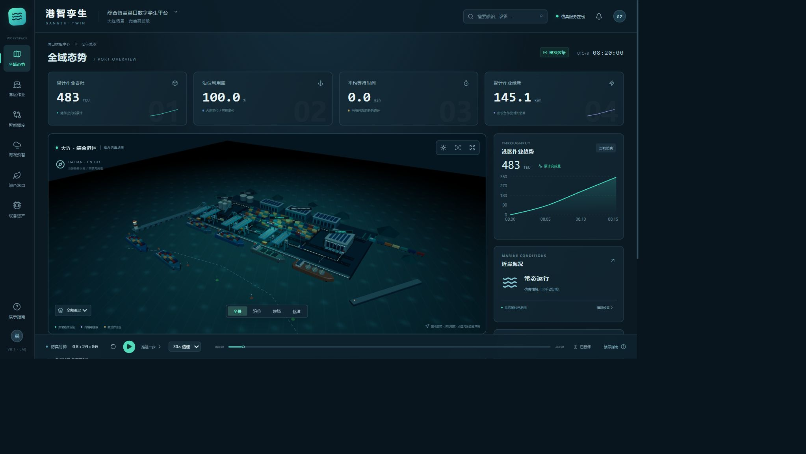
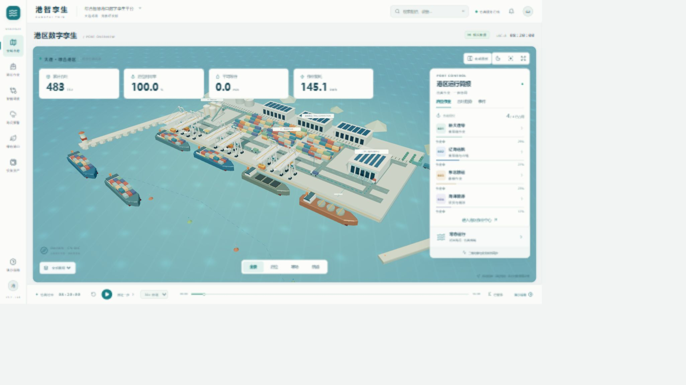
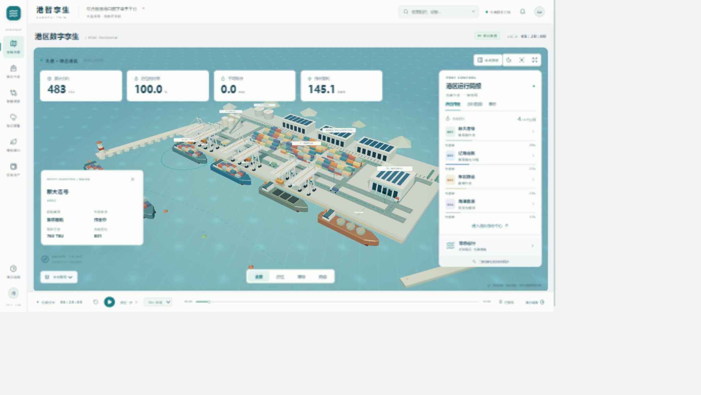
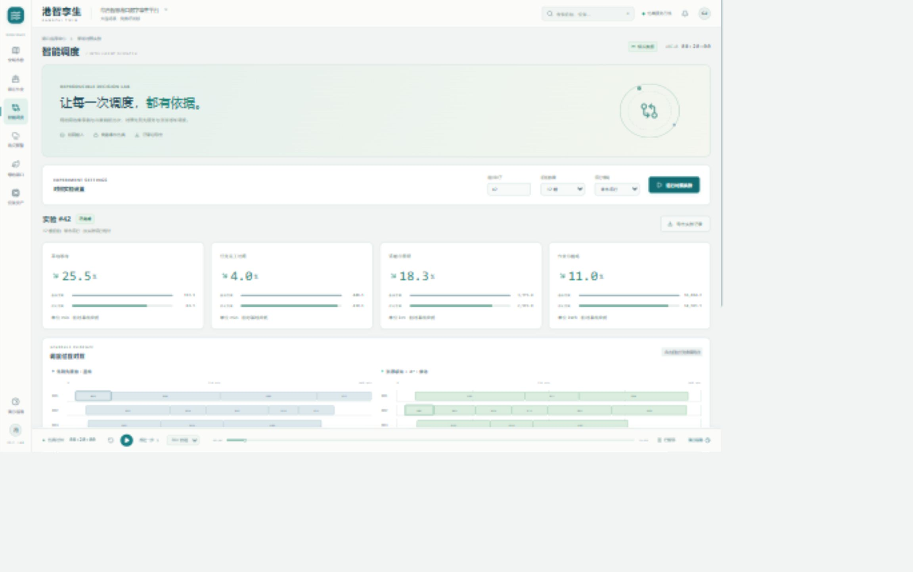
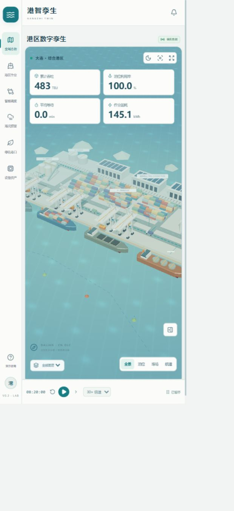

# V0.2 视觉改版与交互核查

日期：2026-10-29。目标：提高整体明度、改善配色、扩大三维港区，保留已有业务与调度能力。

## 依据与改动

参考现有港智孪生页面，以及 `upstream/portwise-original` 中 Portwise 的 `AppShell.tsx` 与 `index.css`：原版采用晨间海图配色，让三维场景成为主体，业务信息悬浮其上。本次借鉴布局原则，没有复制其他未获许可的模型或素材。

改版前的截图显示：页面深色占比高，海面与码头明度接近；大型指标卡和右侧多块面板让三维场景成为次级内容。改版后使用浅色海面、浅色码头、暖白岸桥、深蓝船体与少量橙色信号色；首页场景铺满主体，指标紧凑，运行简报可以收起。

### 改版前

### 改版后

两张截图均为本轮实际捕获，常态情境、08:20 暂停状态。截图接口返回 JPEG 原始数据，原样保存；系统显示缩放及截图压缩会影响文字清晰度，因此未据此声称完成精确像素或字号比对。

## 实际检查步骤

| 步骤 | 操作与观察 | 状态 |
| --- | --- | --- |
| 1 首页 | 浅色界面、三维港区、指标和泊位简报已渲染；收起与展开简报有效 | 通过 |
| 2 实体联动 | 直接点击场景中的船舶，显示新大连号 V002、760 TEU、B01 和作业状态；点击简报船舶也可定位 | 通过 |
| 3 场景控制 | 日景与夜景切换；放大场景后隐藏悬浮简报；Esc 恢复；全景按钮可复位镜头 | 通过 |
| 4 调度实验 | 从导航进入调度页，实际运行种子 42 / 12 艘 / 常态实验，出现四项结果和 24 个成对甘特任务块 | 通过 |
| 5 窄屏 | 运行简报默认收起；四项指标改为两列；镜头、图层和播放控件可见，页面未出现横向溢出 | 通过 |

### 实体选择

### 调度实验

本次默认实验显示等待下降 25.5%、完工时间下降 4.0%、运输里程下降 18.3%、作业能耗下降 11.0%。这些仅是此组模拟输入的计算结果，其他输入可能产生负改善率。

### 窄屏

## 验证范围与后续检查

- 前端严格 TypeScript 检查与生产构建通过。浏览器本轮错误日志为空。
- 生产构建仍提示三维相关代码包较大；尚未进行低配置显卡、移动端真实设备和长时间运行的性能测试。
- Esc 返回已实际验证，控件具有名称和状态标记。尚未进行屏幕阅读器、完整键盘路径或无障碍符合性测试。
- 三维区域标注和小型辅助文字在投影环境下仍需现场确认可读性；窄屏主要用于浏览，竞赛演示建议使用桌面浏览器。
- 当前检查覆盖上述主流程，不将其表述为所有页面、所有异常组合的完整验收。

## 回滚点

工作分支：`feature/gangzhi-dalian-platform`。

- `upstream/portwise-original`：原始 Portwise 仓库版本。
- `snapshot/dark-preview`：本次视觉改版前的港智孪生版本，包含已完成的业务后端和调度实验。

需要对照时，在工作区干净的情况下从标签创建新分支，例如 `git switch -c review-dark snapshot/dark-preview`。无需覆盖或删除当前分支。
