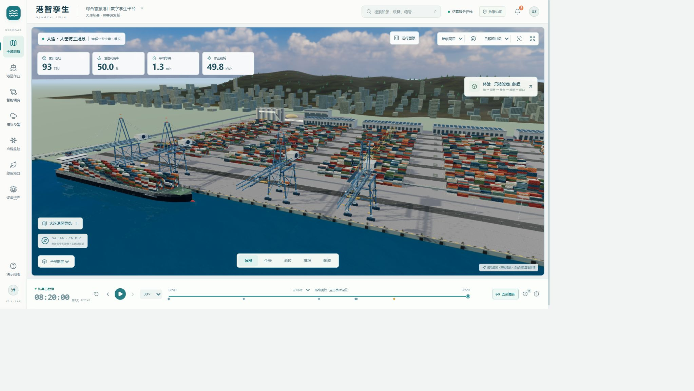
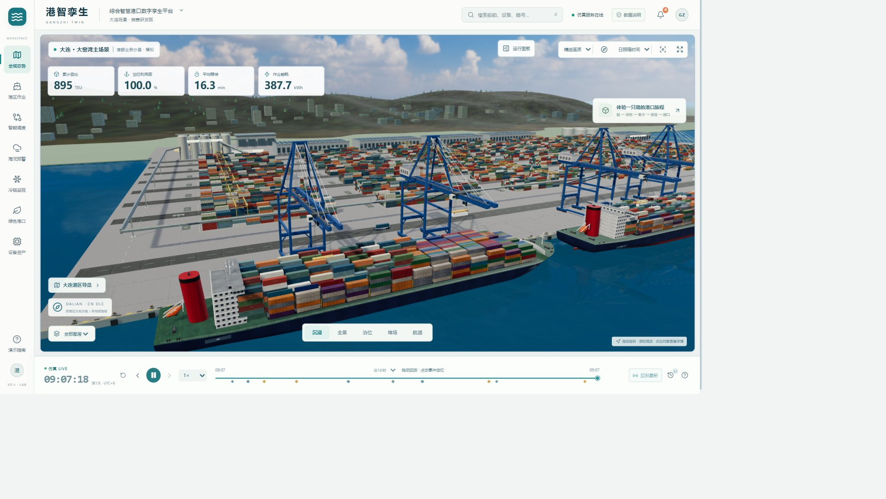

# V0.5 大连主题三维视觉进展

日期：2026-10-29，2026-10-30 补充船岸模型升级。此文档记录实际网页检查；三维仍属于竞赛原型，不是实测大连港模型。

## 本轮落地

- 默认镜头拉近至船岸作业，保留全景、泊位、堆场和航道切换。新增五镜头自动巡航，拖动场景可退出。
- 构建海湾远山与沿岸城市背景，为山体加入 CC0 地表贴图，为楼群加入程序化窗格。该背景只表现大连海湾、山地和滨海城市气质，没有地理坐标或真实建筑轮廓。
- 深蓝海面、蓝色岸桥及安全色细节、船体板缝、集卡传感器外形；故障岸桥变红、天气停工变琥珀色，状态取自设备业务数据。
- 增加散货作业堆场、仓储棚、粮食堆体与输送结构。输送动画仍按后端散货船作业时间推进，其物料数量属于汇总模型。
- “大连港区导览”分别定位集装箱、散货、液货与冷链示意设施，并在页面明确说明真实港区位于不同海湾；此画面是跨港区业务缩略沙盘。

## 实际检查

在本地浏览器打开 `http://127.0.0.1:5180/#overview`，观察到三维场景、海面、集装箱船、桥吊、堆场和背景正确渲染。点击巡航后出现“海湾全景”等镜头说明；打开导览并点击“大孤山港区”，镜头移动到散货设施，详情显示 B03、累计作业量及船舶作业状态。点击“沉浸”恢复主镜头。浏览器日志未见运行错误，有 Three.js `Clock` 弃用提示。

`npm run build` 和 `npm run test:scene` 通过；构建仍有三维代码块大于 500 kB 的提示。未对低配置显卡、长时间巡航、移动端实体选择和每个异常组合进行完整压力测试。

## 2026-10-30 船岸模型升级复看

上一张画面中的方块船体与简化岸桥差距明显。本次将集装箱船的船壳、艏艉、甲板、驾驶楼与救生艇换为具有实测标称尺寸的 CC0 GLB；岸桥主体换为带有桁架、步道、机械房和钢索的 CC0 GLB。模型详见根目录 `THIRD_PARTY_NOTICES.md`。船上可变箱列仍按仿真进度减少；岸桥的小车和吊具仍由任务状态驱动。原程序化船体、岸桥保留在代码中作为模型加载失败时的回退，并可通过 Git 回滚标签恢复。

镜头调整为船岸作业近景；修正了海面旁出现的大块矩形绿地，并降低背景城市的方块密度。截图是在浏览器中运行的三维页面，而非用户照片贴图。网页可见两艘船、岸桥、堆场及动态仿真时钟；浏览器控制台未出现模型加载错误。前端构建、场景资源哈希校验及 `/api/health` 均通过。

## 仍需达到的质量

当前画面已有可交互的三维建筑和设备，但尚未达到用户提供的智慧港口视频与真实港口照片的写实水平。新船舶与岸桥按模型标称米制尺寸放入仿真坐标，仍没有经过大连港现场实拍、摄影测量或 BIM 校准；城市、山体和散货区是程序化示意。港群设施被放在同一沙盘，不能用于判断真实港区方位或设施间距离。下一步应优先取得可合法使用的港区测绘/建筑/设备参考，再按实际尺度重建关键码头，逐个镜头做照片对照。真实海况、AIS 和生产作业数据仍未接入。
